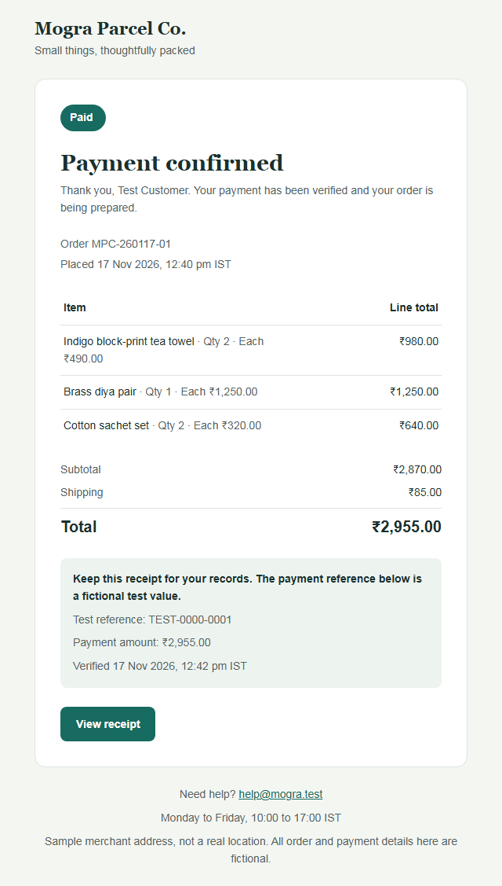
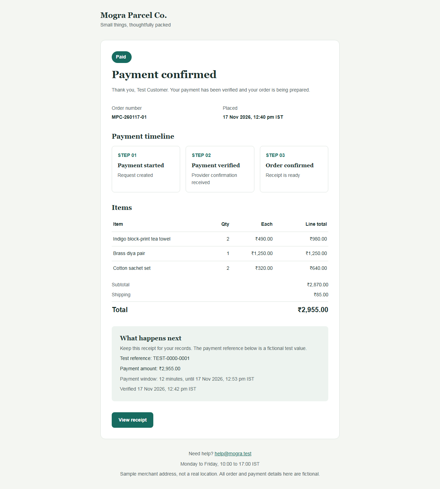
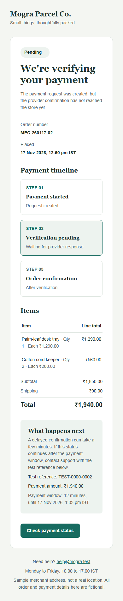
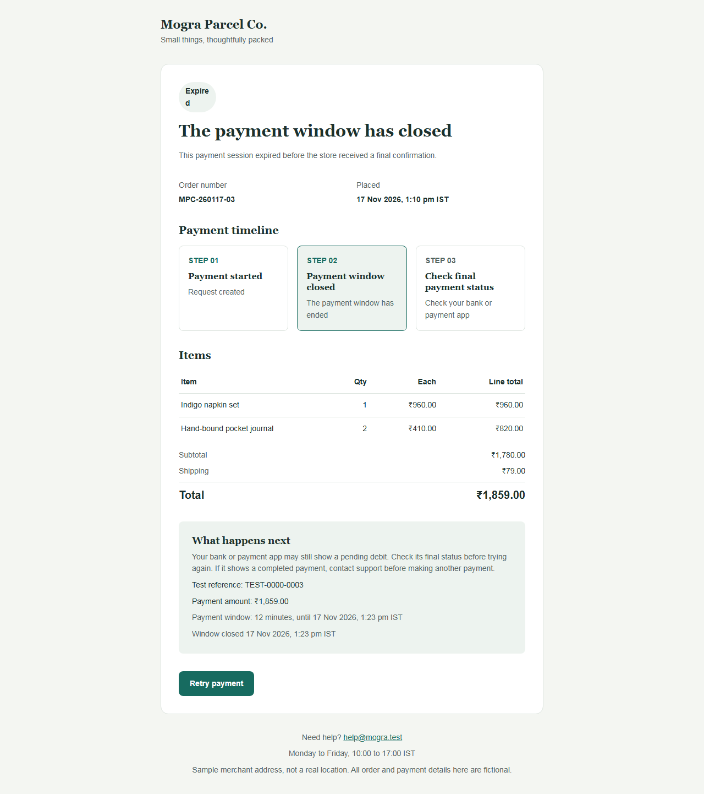
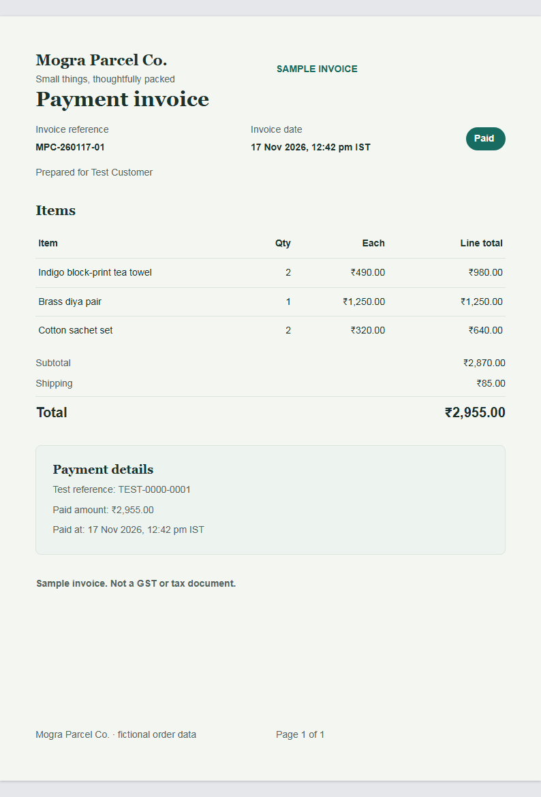

# UPI Receipt Kit

UPI Receipt Kit is a fictional Indian shop that turns one order fixture into a confirmation email, a no-JavaScript web receipt, and a paid-only A4 invoice. Each output supports paid, pending-verification, and expired payment states, with INR totals calculated from item prices and shipping.

## Screenshots

**Email**



**Web receipts**







**Invoice**



## Quick start

Node.js 20 or newer is required. Install the project dependencies, install the Playwright Chromium browser once, then build the output files:

```bash
npm install
npx playwright install chromium
npm run build
```

To open the output index locally, run this in another terminal after the build:

```bash
npm run preview
```

Open `http://127.0.0.1:4173`. The index links every generated file and shows each email in a 600 px frame.

Other useful commands:

```bash
npm run screenshots
npm run typecheck
npm test
```

`npm test` builds the outputs before running Vitest. `npm run screenshots` captures the current generated files in `docs/screenshots/`.

## Outputs

- `output/email-paid.html` and `output/email-paid.txt`: payment confirmation.
- `output/email-pending.html` and `output/email-pending.txt`: payment verification is still pending.
- `output/email-expired.html` and `output/email-expired.txt`: the payment window has closed, with careful retry guidance.
- `output/receipt-paid.html`, `output/receipt-pending.html`, and `output/receipt-expired.html`: responsive web receipts with a status timeline.
- `output/invoice.html` and `output/invoice.pdf`: print HTML and a one-page A4 PDF for the paid order only.
- `output/index.html`: a local index for the generated files.

## How someone can use this

This repository is a developer starter and a working example, not a live payment product. The generated HTML pages let anyone preview the designs, while the TypeScript source shows how one order object can produce matching email, web receipt, and PDF versions.

A shop developer can replace the fictional merchant and order fixtures with their own data, then connect the templates to the shop's backend. The backend can provide each real order's items and payment state to generate a receipt. The shop can serve the web version, send the email version through an email service, and offer the PDF as a download.

The project does not include checkout, payment verification, customer-specific data handling, an email-sending service, or deployment. The included states and receipts are fixed fictional samples. A developer must build those integrations and handle real customer and payment data securely before using this for actual orders. The sample invoice is not a GST or tax document.

## How the data drives the templates

`data/merchant.json` holds the fictional shop details. Each file in `data/orders/` holds an order, its item prices, an email subject and preheader, and fake payment references and timestamps. `src/data.ts` checks those values, calculates each line amount, subtotal, shipping, total, and payment amount, then formats money with `Intl.NumberFormat("en-IN")`.

The three roots in `src/templates/` use the shared colors, type, spacing, and components in `src/theme.ts` and `src/components/`. The same order object is passed to the email, web, and paid invoice templates. No totals are copied into the order fixtures.

## How Hyper Elements is used

The project uses `@hyper-elements/react` version 0.4.6 to define three React template roots: `Email` for the email, `Page` for responsive web receipts, and `Document` for the print-ready A4 invoice. Each root receives the same merchant and order data and uses shared components and theme tokens.

In `scripts/build.ts`, the library's `render()` function turns each template into HTML and, for emails, plain text. The build writes those results to `output/` and checks renderer diagnostics for warnings. For the invoice, the `Document` template produces print-ready HTML, then Playwright opens it in Chromium and saves an A4 PDF with `page.pdf()`.

## Project layout

```text
data/                  Fictional merchant and order fixtures
src/components/        Shared header, table, status, timeline, totals, and footer
src/templates/         Email, web receipt, and invoice roots
scripts/               Build, preview server, and screenshot commands
output/                Generated HTML, text, and PDF committed for review
tests/                 Vitest checks
docs/screenshots/       Generated screenshots
```

## Limits

All merchant, customer, order, reference, email, and link values are fictional. The `.test` links do not connect to a payment provider, and this project does not send email or verify payments. The invoice is a sample only and is not a GST or tax document.

The pages and emails were checked in headless Chromium. Real Gmail and Outlook clients, email delivery, other PDF readers, and print hardware were not tested. No live payment system, deployment, Hindi locale, or QR code is included.

## License and credits

The project is licensed under MIT. The challenge announcement and accessible FAQ do not specify a project license requirement.

Hyper Elements is used from [`@hyper-elements/react`](https://www.npmjs.com/package/@hyper-elements/react), version 0.4.6. The project uses system font stacks: Arial, Nirmala UI as a rupee-glyph fallback, and Georgia. It does not download or bundle font files.
